# Eyelash Corne — ZMK config

**Это не [Corne от foostan](https://github.com/foostan/crkbd), стандартная прошивка `corne` на него не подходит.** Плата описана в `boards/arm/eyelash_corne/` этого репо.

## Управление

Fn включается удержанием **пробела** (левый большой) или **Enter** (правый большой). Все сочетания ниже работают только на Fn.

| Что | Как |
|---|---|
| Bootloader (прошивка) левой половины | Fn + **Tab Q W** |
| Bootloader правой половины | Fn + **O P [** |
| Перезагрузка левой половины | Fn + **Tab Esc Caps** (крайний левый столбец) |
| Перезагрузка правой половины | Fn + **[ ' и правый нижний угол** (крайний правый столбец) |
| Выключить (глубокий сон) | Fn + **Q S Z**, держать 2 с. Разбудить: кнопка reset на плате |
| Bluetooth-профиль 0 / 1 / 2 / 3 | Fn + **Z / X / C / V** |
| Переключить USB ⇄ Bluetooth | Fn + **B** |
| Стереть текущий BT-профиль | Fn + **Esc** (крайняя левая в среднем ряду) |
| Скриншот области в файл (Cmd+Shift+4) | Fn + **N** |
| Скриншот области в буфер (Cmd+Ctrl+Shift+4) | Fn + **M** |

Слои: **NUMBER** — держать левый большой рядом с пробелом, **SYMBOL** — держать правый большой рядом с Enter.
Левый нижний угол — Caps Lock, правый нижний — Option+Space (переключение раскладки в macOS).
После часа без нажатий клавиатура засыпает, просыпается от любой клавиши.

## Прошивка

1. Сборка идёт в GitHub Actions на push в `main`. Ветку можно собрать вручную: `gh workflow run build.yml --ref <ветка>`.
2. Скачать архив `firmware` со страницы сборки: `gh run download <run-id> -n firmware`.
3. Перевести половину в bootloader (сочетание выше или двойное нажатие reset на плате) — появится USB-диск.
4. Скопировать на диск `.uf2` для этой половины (`*left*` или `*right*`). Повторить для второй половины.

Полный сброс настроек и BT-сопряжений: прошить обе половины `settings_reset`, затем снова обычную прошивку.

## Раскладка

